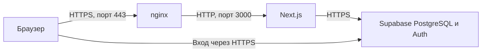
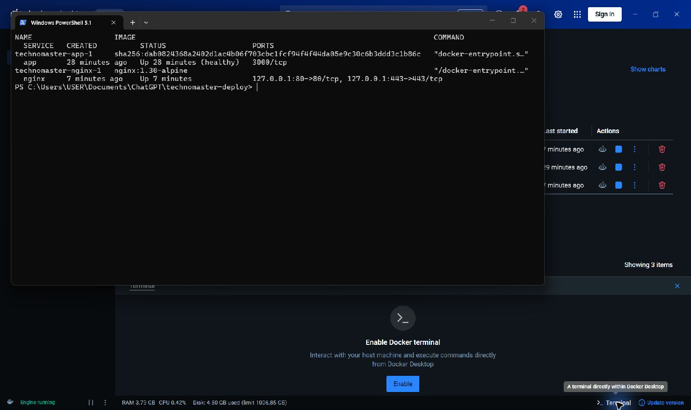
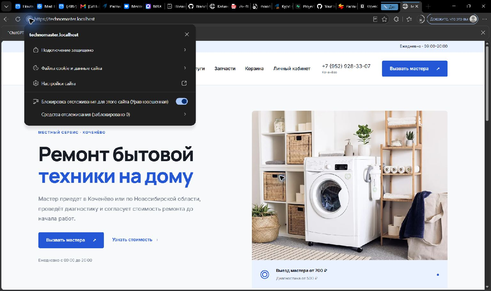
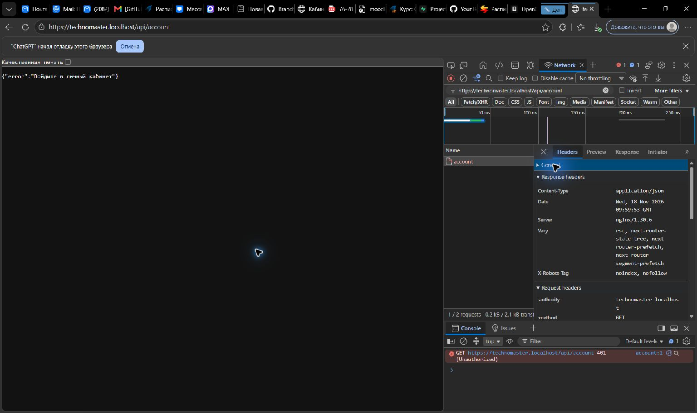
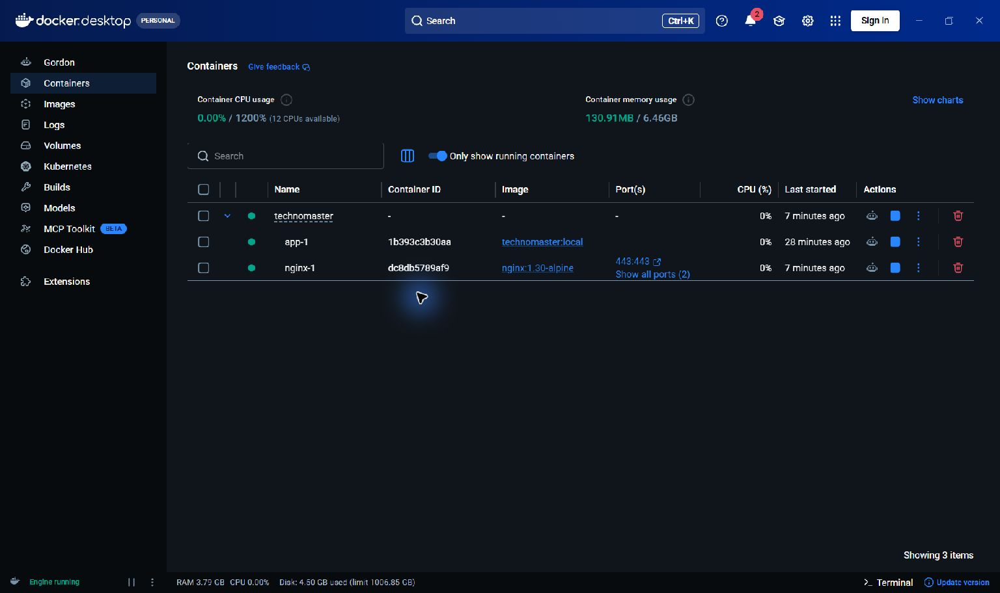
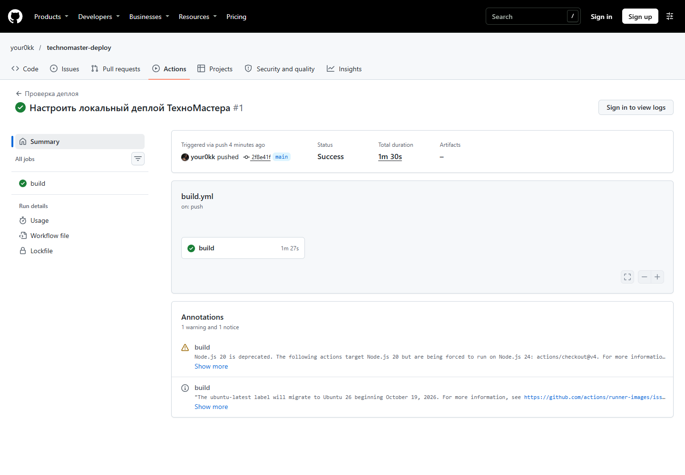

# Практическое занятие №18

Деплой приложения «ТехноМастер» на локальном компьютере.

Выполнил Ушаков Юрий Сергеевич, группа ПР-25.106.

ГБПОУ НСО «Новосибирский авиационный технический колледж имени Б.С. Галущака».

Цель работы — подготовить production-запуск приложения, настроить обратный прокси, локальный домен и HTTPS, проверить сборку в GitHub Actions.

## Устройство проекта



| Сервис | Технология | Внутренний порт | Сервер |
| --- | --- | --- | --- |
| app | Next.js, TypeScript | 3000 | Node.js, standalone-сборка |
| nginx | nginx | 80, 443 | nginx |
| Внешняя БД и авторизация | Supabase | 443 | Облачный сервис |

Next.js объединяет страницы и API в одном приложении. nginx принимает запросы, завершает TLS и передает их приложению. На компьютере опубликованы только порты nginx с привязкой к 127.0.0.1. Supabase остается внешним сервисом.

## Окружение

В файле `webka/.env.local` используются `NEXT_PUBLIC_SUPABASE_URL`, `NEXT_PUBLIC_SUPABASE_ANON_KEY` и `SUPABASE_SERVICE_ROLE_KEY`. Первые две переменные нужны при сборке браузерного кода. Серверный ключ передается только при запуске приложения. Значения переменных в репозитории отсутствуют.

Dockerfile использует многоэтапную сборку и запускает сервер от пользователя node. Сертификат и закрытый ключ подключаются к nginx как файлы только для чтения. Папка certs исключена из Git и контекста сборки.

## Запуск

Команды выполняются из корня technomaster-deploy. Требуются Docker Desktop, mkcert, заполненный `.env.local` и локальное доверие сертификату.

Репозитории располагаются рядом. Папка приложения называется `webka`, папка этой работы — `technomaster-deploy`. Для воспроизведения используется проверенная версия приложения после исправлений кабинетов, заказов и SEO, коммит `1b75e727390a97c824962a12aef26fba2e5cf0cb`.

```powershell
git clone https://github.com/your0kk/technomaster.git webka
git -C webka checkout 1b75e727390a97c824962a12aef26fba2e5cf0cb
git clone https://github.com/your0kk/technomaster-deploy.git
cd technomaster-deploy
New-Item -ItemType Directory -Force deploy/certs
```

```powershell
mkcert -install
mkcert -cert-file deploy/certs/technomaster.localhost.pem -key-file deploy/certs/technomaster.localhost-key.pem technomaster.localhost
docker compose --env-file ../webka/.env.local -f deploy/docker-compose.yml up --build -d
docker compose --env-file ../webka/.env.local -f deploy/docker-compose.yml ps
docker compose --env-file ../webka/.env.local -f deploy/docker-compose.yml logs --tail 30
```

Адрес проекта — https://technomaster.localhost. Запросы по HTTP перенаправляются на HTTPS. Для остановки используется команда

```powershell
docker compose --env-file ../webka/.env.local -f deploy/docker-compose.yml down
```

## Проверка сборки

Workflow этого репозитория запускается при push, pull_request и вручную через workflow_dispatch. Он получает исходный код приложения указанной версии, проверяет Compose, собирает Docker-образ, проверяет запуск контейнера и конфигурацию nginx. Для проверки nginx в CI выпускается временный самоподписанный сертификат. На компьютере используется доверенный сертификат mkcert.

В основном репозитории сохранен workflow практической №15 с проверками кода и публикацией образа в GHCR после push в main.

## Результаты проверки

Работа выполнена 18 ноября 2026 года на Windows с Docker Desktop. Сборка Next.js завершилась успешно. Контейнер приложения получил состояние healthy. Проверены 12 адресов страниц и служебных файлов, они возвращают HTTP 200. Каталог загружает данные из Supabase, товар добавляется в корзину и сохраняется после обновления страницы.

Входы клиента, администратора и мастера проверены с существующими учебными учетными записями. Их API возвращают 200 после входа, а обращение с чужой ролью — 403. Без авторизации `/api/account` возвращает 401 и заголовок `X-Robots-Tag: noindex, nofollow`. Перенаправление с HTTP возвращает 301. Edge показывает защищенное соединение с локальным доменом.

Сервер работает от пользователя node. Проверка файлов контейнера подтвердила отсутствие `.env.local`, ключей и сертификатов. Регистрация новых пользователей и создание новых заказов в ходе этой проверки не выполнялись.



Рисунок 1 — Состояние сервисов. Приложение healthy, порты 80 и 443 опубликованы только на 127.0.0.1.



Рисунок 2 — Главная страница по локальному домену и подтверждение защищенного соединения в Edge.



Рисунок 3 — Ответ API без входа и заголовок X-Robots-Tag на вкладке Network.



Рисунок 4 — Контейнеры app и nginx. Внешние порты назначены только nginx.



Рисунок 5 — Успешная сборка и проверка конфигурации в GitHub Actions.

## Ошибки при выполнении

| Проблема | Решение |
| --- | --- |
| Команда docker не находила работающий движок | Запущен Docker Desktop, проверено подключение к Linux Engine. |
| Supabase был приостановлен, каталог ожидал данные | Проект восстановлен через Supabase. После восстановления повторены проверки каталога и входов. |
| Windows запрашивала доверие локальному центру сертификации | Установлен центр mkcert с подтверждением пользователя. |
| Проверка API из Node.js не доверяла локальному сертификату | Для проверочного скрипта включено системное хранилище сертификатов флагом `--use-system-ca`. |
| curl не мог проверить отзыв локального сертификата | Для локальной проверки использован `--ssl-revoke-best-effort`. Доверие к сертификату дополнительно проверено в Edge. |

После обновления Next.js и зависимостей проверка npm audit --omit=dev сообщает об отсутствии известных уязвимостей производственных пакетов. Для инструментов разработки сохраняются предупреждения аудита. Ошибки API, формируемые nginx, получают X-Robots-Tag через add_header always. Регистрация ограничена по частоте на уровне nginx.

## Вывод

Подготовлен локальный запуск приложения через Docker Compose. nginx принимает HTTPS-запросы и передает их Next.js. Проверены соединение с базой, корзина, входы и разграничение доступа. Конфигурация сборки проверяется автоматически в GitHub Actions.

## Ссылки

- [Исходный проект](https://github.com/your0kk/technomaster)
- [Версия приложения для этой работы](https://github.com/your0kk/technomaster/tree/1b75e727390a97c824962a12aef26fba2e5cf0cb)
- [Успешный запуск Actions](https://github.com/your0kk/technomaster-deploy/actions/runs/44280602534)
- [Docker Compose](https://docs.docker.com/compose/)
- [mkcert](https://github.com/FiloSottile/mkcert)

## Переход на сервер

Для размещения потребуется сервер, домен с DNS-записью и сертификат публичного центра сертификации. Также нужно настроить хранение секретов, резервное копирование, параметры авторизации и доставку обновлений. До публикации необходимо проверить условия обработки и размещения пользовательских данных.


