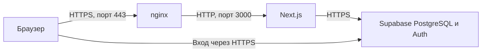

# Практическое занятие №18

Деплой приложения «ТехноМастер» на локальном компьютере.

Выполнил Ушаков Юрий Сергеевич, группа ПР-25.106.

## Устройство проекта



| Сервис | Технология | Внутренний порт | Сервер |
| --- | --- | --- | --- |
| app | Next.js, TypeScript | 3000 | Node.js, standalone-сборка |
| nginx | nginx | 80, 443 | nginx |
| Внешняя БД и авторизация | Supabase | 443 | Облачный сервис |

Next.js объединяет страницы и API в одном приложении. nginx принимает запросы, завершает TLS и передает их приложению. На компьютере опубликованы только порты nginx с привязкой к 127.0.0.1. Supabase остается внешним сервисом.

## Окружение

В файле `webka/.env.local` используются `NEXT_PUBLIC_SUPABASE_URL`, `NEXT_PUBLIC_SUPABASE_ANON_KEY` и `SUPABASE_SERVICE_ROLE_KEY`. Первые две переменные нужны при сборке браузерного кода. Серверный ключ передается только при запуске приложения. Значения переменных в репозитории отсутствуют.

Dockerfile использует многоэтапную сборку и запускает сервер от пользователя node. Сертификат и закрытый ключ подключаются к nginx как файлы только для чтения. Папка certs исключена из Git и контекста сборки.

## Запуск

Команды выполняются из корня technomaster-deploy. Требуются Docker Desktop, mkcert, заполненный `.env.local` и локальное доверие сертификату.

```powershell
mkcert -install
mkcert -cert-file deploy/certs/technomaster.localhost.pem -key-file deploy/certs/technomaster.localhost-key.pem technomaster.localhost
docker compose --env-file ../webka/.env.local -f deploy/docker-compose.yml up --build -d
docker compose --env-file ../webka/.env.local -f deploy/docker-compose.yml ps
docker compose --env-file ../webka/.env.local -f deploy/docker-compose.yml logs --tail 30
```

Адрес проекта — https://technomaster.localhost. Запросы по HTTP перенаправляются на HTTPS. Для остановки используется команда

```powershell
docker compose --env-file ../webka/.env.local -f deploy/docker-compose.yml down
```

## Проверка сборки

Существующий workflow запускается при push, pull_request и вручную через workflow_dispatch. Он проверяет код, собирает Next.js и Docker-образ, проверяет контейнер и синтаксис Compose. Публикация в GHCR выполняется после успешного push в main.

## Переход на сервер

Для размещения потребуется сервер, домен с DNS-записью и сертификат публичного центра сертификации. Также нужно настроить хранение секретов, резервное копирование, параметры авторизации и доставку обновлений. До публикации необходимо проверить условия обработки и размещения пользовательских данных.

